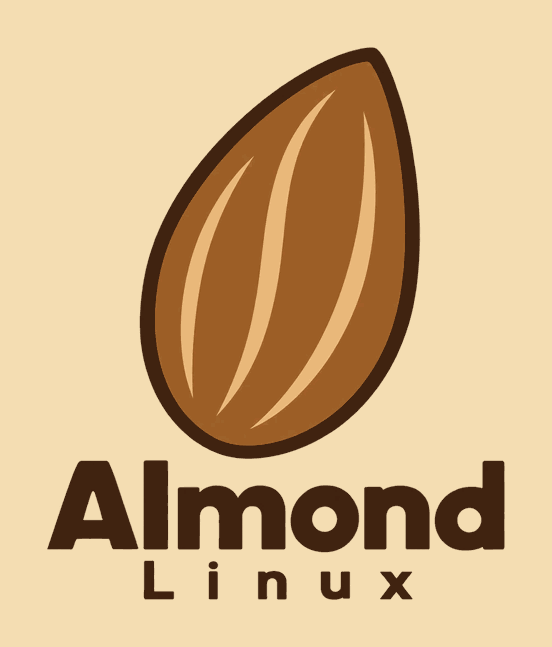

<p align="center">
  
</p>

<h1 align="center">Almond Linux</h1>

<p align="center"><strong>Simple. Powerful. Yours.</strong></p>

<p align="center">
  <a href="https://almondlinux.github.io">Website</a> ·
  <a href="docs/ROADMAP.md">Roadmap</a> ·
  <a href="docs/BUILD.md">Build notes</a> ·
  <a href="CONTRIBUTING.md">Contributing</a>
</p>

---

Almond Linux is an independent Linux distribution project focused on simplicity, stability, performance, and freedom. The initial operating system will be based on Debian. The long-term goal is for Almond to become a fully independent distribution of its own.

> **Status: early development.** No ISO has been built, booted or released. Nothing in this repository is ready to install. See [Project status](#project-status).

## Names

| Name | Meaning |
|---|---|
| **Almond Linux** | The official project name. Short name: **Almond**. |
| **AALLDM** | **A All Large Linux Distribution Model** — the large edition: a bigger, more modern desktop for newer PCs. |
| **AALDM** | **A All Little Distribution Model** — the little edition: a lighter system for older and low-power 64-bit PCs. |

Release codenames are Spanish almond varieties: **0.1 "Marcona"**, **0.2 "Largueta"**, **0.3 "Valencia"**. Later releases are not named yet.

## Project status

As of 14 October 2026:

| Area | State |
|---|---|
| Build configuration (live-build, ARM64 UEFI VM) | First draft. Checked: shell syntax, and that the build script refuses to run outside Linux. |
| ISO image | Not built yet |
| Boot, networking, security defaults, installation | Not tested yet |
| Editions | Defined; desktop per edition, minimum hardware and which edition comes first are not decided |
| Website | [almondlinux.github.io](https://almondlinux.github.io) |

## Roadmap

| Version | Goal | Status |
|---|---|---|
| 0.1 "Marcona" | First bootable Debian-based ISO | In progress |
| 0.2 "Largueta" | Custom Almond branding, wallpaper, themes, and system identity | Planned |
| 0.3 "Valencia" | Customized desktop experience | Planned |
| 0.5 | Graphical installer and testing | Planned |
| 1.0 | First stable public release | Planned |

A milestone is only marked done when its evidence exists (ISO hash, build log, boot tests and so on). After 1.0, Almond plans to become independent of Debian one layer at a time. Details: [docs/ROADMAP.md](docs/ROADMAP.md).

## Technical direction

- **Base:** Debian Stable, currently Debian 13 "trixie".
- **Build tool:** [Debian live-build](https://wiki.debian.org/DebianLive).
- **First target:** an ARM64 UEFI virtual machine. The draft 0.1 preview image uses the Xfce desktop; the desktop for each edition is still undecided.
- **Testing:** in virtual machines (QEMU/KVM, UTM, or VirtualBox where it supports the architecture) before any real hardware.
- **Not a goal:** native installation on Apple Silicon Macs.

Architecture notes: [docs/ARCHITECTURE.md](docs/ARCHITECTURE.md). How to try a build: [docs/BUILD.md](docs/BUILD.md).

## Repository layout

```
auto/config                     live-build configuration
config/package-lists/           packages in the image
config/hooks/live/              image customisation (Almond identity)
scripts/build.sh                guarded build wrapper (refuses to run unless on Debian 13 arm64 as root;
                                meant for a dedicated build VM)
docs/                           architecture, build notes, roadmap
branding/                       the official Almond logo
```

## Contributing

Almond is at the very beginning, so the most useful help right now is careful testing, review and honest feedback. Read [CONTRIBUTING.md](CONTRIBUTING.md) first. Everyone taking part is expected to follow the [Code of Conduct](CODE_OF_CONDUCT.md).

Security problems: please report them privately, as described in [SECURITY.md](SECURITY.md), never in a public issue.

## License

Almond's own files (build configuration, scripts and documentation) are released under the [MIT License](LICENSE).

- **Upstream software keeps its own licenses.** An Almond image is assembled mainly from Debian packages; each keeps its original license and copyright. The MIT License does not relicense them.
- **The name and logo are not covered by the MIT License.** "Almond Linux" and the almond logo identify this project. Please do not use them in a way that suggests something is an official Almond release when it is not.

## Disclaimer

Almond Linux is in early development and comes with no warranty. Do not install anything from this project on a computer you care about.

Almond Linux is an independent project and is not affiliated with, endorsed by or sponsored by Debian, Canonical, Red Hat, AlmaLinux, or any other Linux organization. Linux® is the registered trademark of Linus Torvalds in the U.S. and other countries. Debian is a registered trademark owned by Software in the Public Interest, Inc.
